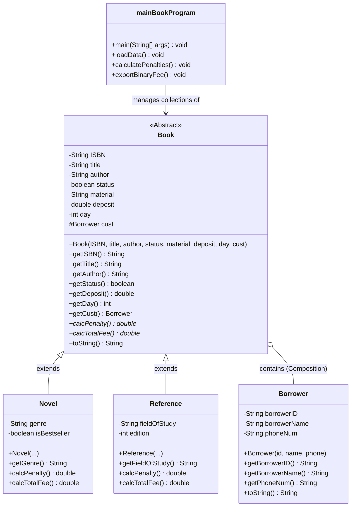

# 📚 Book Rental Management System — Object-Oriented Library Circulation & Penalty Engine

[](https://www.oracle.com/java/)
[]()
[]()
[]()
[](LICENSE)

> **Book Rental Management System** is an Object-Oriented Java software application that automates library book cataloging, circulation tracking, borrower management, and late-fee/replacement penalty calculations. Built using strict OOP design principles (**Abstract Classes**, **Polymorphic Inheritance**, and **Object Composition**), it manages diverse media types (`Novel` and `Reference`) alongside binary file serialization (`.dat`).

---

## 📌 Problem Background & System Goals

Librarians and book rental administrators managing extensive collections often face operational strain when relying on manual index cards:
* **Catalog Clutter:** Difficulties tracking whether returned items are standard fiction paperbacks or non-circulating reference volumes.
* **Circulation Disputes:** Inaccuracies when calculating overdue return penalties, security deposit refunds, and replacement charges for lost materials.
* **Audit Trail Loss:** Difficulty aggregating daily rental revenue and customer borrowing histories across multiple physical folders.

**Book Rental Management System** solves these challenges by providing:
* **Abstract Polymorphic Cataloging:** A unified `Book` abstraction subclassed into `Novel` and `Reference`, each maintaining distinct loan durations, deposit rules, and fine structures.
* **Borrower Profile Composition:** Associates borrower identification, contact numbers, and rental timestamps directly with loaned book instances (`Borrower cust`).
* **Automated Penalty Calculation:** Dynamically calculates overdue fines based on elapsed rental days and assesses replacement fees if items are declared missing.
* **Persistent File Storage & Serialization:** Ingests raw book and borrower data from formatted flat files and writes audited billing statements to binary data streams (`BorrowerFee.dat`).

---

## 🏗️ Object-Oriented Architecture & Class Model



---

## 💰 Rental Rates & Penalty Specifications

| Material Type | Max Loan Period | Security Deposit | Overdue Fine Rate | Lost Material Penalty |
|---|---|---|---|---|
| **Novel (Fiction / Literature)** | 14 Days | RM 10.00 | RM 0.50 / day overdue | Full book retail cost + RM 15.00 admin processing |
| **Reference (Academic / Technical)** | 7 Days | RM 25.00 | RM 1.50 / day overdue | Full book retail cost + RM 30.00 replacement surcharge |

---

## 📂 Project Directory Structure

```text
Book_Rental_Management_System/
├── Book.java                # Abstract base class defining common catalog attributes
├── Novel.java               # Subclass modeling fiction and novel materials
├── Reference.java           # Subclass modeling academic and reference volumes
├── Borrower.java            # Borrower entity (ID, name, phone, loan metadata)
├── mainBookProgram.java     # Main driver, I/O processing & penalty engine
├── NovelData.txt            # Seed catalog records for novel titles
├── ReferenceData.txt        # Seed catalog records for reference titles
├── BorrowerData.txt         # Active borrower registry seed data
├── BorrowerDetails.txt      # Formatted operational rental audit log
├── BorrowerFee.dat          # Binary serialized transaction fee output
├── README.md                # System documentation and OOP design guide
└── .gitignore               # Excludes compiled bytecode (.class)
```

---

## 🛠️ Compilation & Execution Guide

### 1. Prerequisites
* **Java Development Kit (JDK):** Version 8 or newer (`javac -version`).

### 2. Clone the Repository
```bash
git clone https://github.com/akhmal02/Book_Rental_Management_System.git
cd Book_Rental_Management_System
```

### 3. Compile the Java Source Files
```bash
javac Borrower.java Book.java Novel.java Reference.java mainBookProgram.java
```

### 4. Run the Application
```bash
java mainBookProgram
```

The application will read data from `NovelData.txt`, `ReferenceData.txt`, and `BorrowerData.txt`, process late penalties, and export the generated transaction summary into `BorrowerDetails.txt` and `BorrowerFee.dat`.

---

## 👨‍💻 Authors & Academic Attribution
* **Development Team:**
  * **Muhammad Akhmal bin Mohamad Hussin** (2022870756) — [@akhmal02](https://github.com/akhmal02)
  * Nik Yusuf (2022606254)
  * Rizalliff Nabil (2022451146)
  * Muhammad Syafiq (2022831866)
* **Class:** CS1102B
* **Advisor / Lecturer:** Madam Norzalina binti Ismail
* **Institution:** Universiti Teknologi MARA (UiTM)
* **Faculty:** College of Computing, Informatics and Mathematics
* **Course:** Object-Oriented Programming (CSC248)
